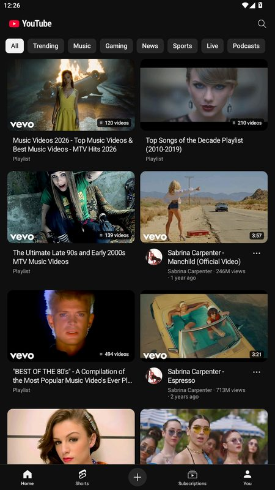
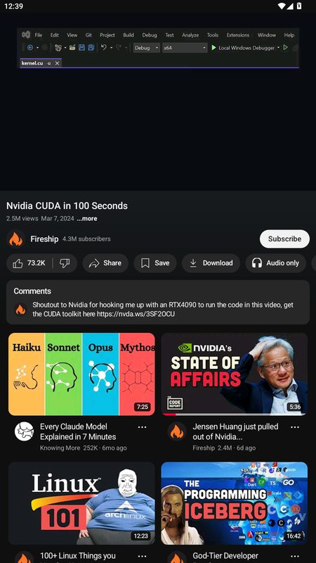
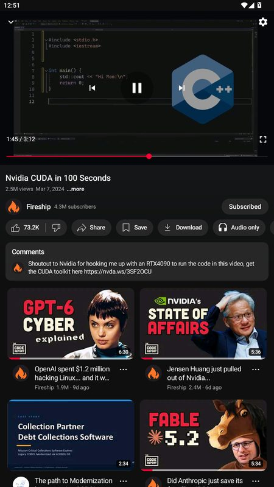
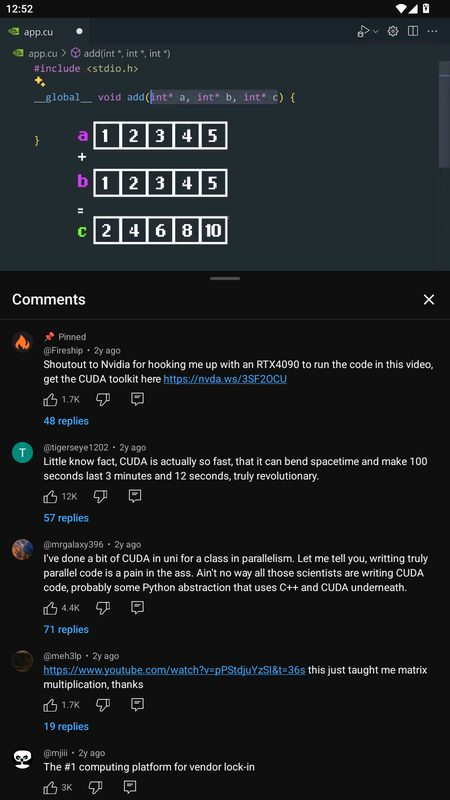
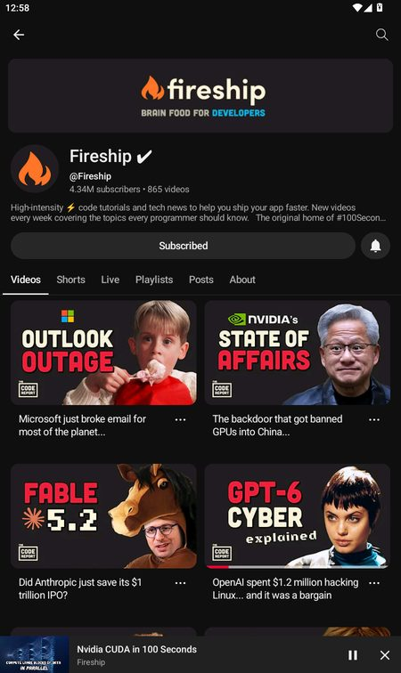
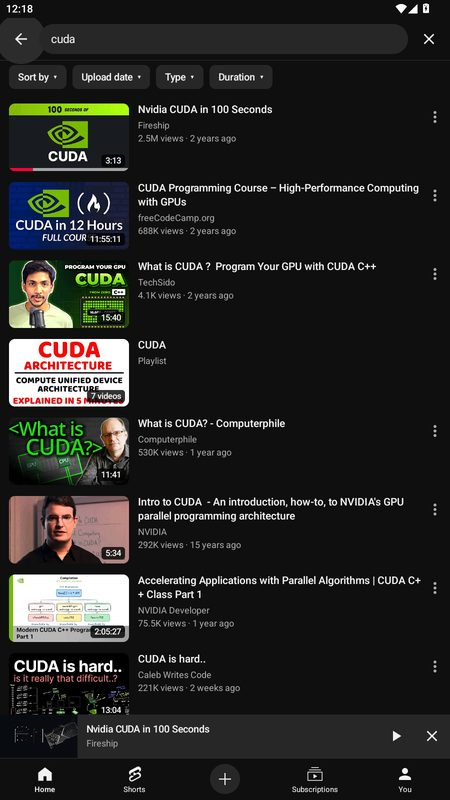
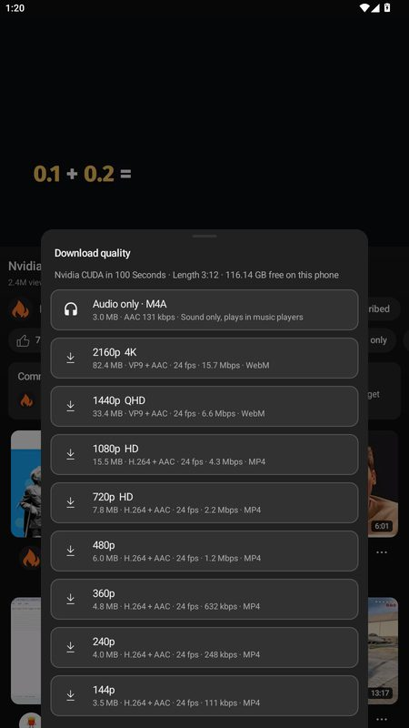

<div align="center">

  

  <h1>PlayTube</h1>

  <h3>YouTube and YouTube Music for Android, signed in with your own account, without ads, played by a native player.</h3>

  <p>
    
    <a href="https://github.com/Talhary/youtube-client/releases/latest"></a>
    
    
  </p>

  <p>
    PlayTube looks and works like YouTube's own app: the same Home, Shorts, Subscriptions and You tabs,
    the same watch page and mini player. Underneath, videos play in Android's own media player
    (ExoPlayer), fed by a stream resolver that runs on the phone. No web view, no ads.
  </p>

  <p>
    <a href="https://github.com/Talhary/youtube-client/releases"><b>Download APK</b></a> ·
    <a href="#features"><b>Features</b></a> ·
    <a href="#screenshots"><b>Screenshots</b></a> ·
    <a href="#building"><b>Building</b></a>
  </p>
</div>

---

## Why PlayTube?

Alternative YouTube clients usually make you choose: privacy and no ads, or your own account with its
recommendations, subscriptions, history and playlists. PlayTube keeps your account. You sign in once
on Google's own page inside the app; the session stays on the phone and the app reads your personal
Home, Subscriptions, history and library from YouTube directly.

What changes is the playing. Videos are resolved to their streams on the phone and played by the
native player, so there are no ads, playback continues in the background and in picture-in-picture,
and the battery lasts longer than with a web page.

---

## Features

### Looks like YouTube
- YouTube's layout and colours: logo bar, filter chips, bottom bar (Home, Shorts, Create, Subscriptions, You) with your account picture
- Full-width video cards (two columns on wide screens), Shorts shelf on Home, channel row on Subscriptions
- Sharp thumbnails: a small picture first, then YouTube's 1280×720 one
- Watch page in YouTube's order: title, views and age with "...more", channel with Subscribe, like/dislike pill with the count, actions, comments card, related videos
- Floating mini player at the bottom right with a progress line; pull the page down to shrink the video
- Dark and light themes

### Playback
- Native ExoPlayer (Media3) playback, hardware-decoded H.264 / VP9 / AV1, up to 4K
- No ads
- Background playback with a media notification, picture-in-picture
- Quality, speed, captions, dubbed audio tracks and "stable volume"
- Chapters, seek-bar preview pictures, resume where you left off
- Playback in feeds: the video most in view (or the one you touch) plays inside its card, with sound (always, Wi-Fi only or off)
- Live streams (HLS) and live chat
- Optional brightness/volume swipes in fullscreen
- Play on TV (DIAL), sleep timer, loop, play queue

### Shorts
- Native Shorts feed from YouTube's own Shorts API: swipe up and down, no web view
- Like, dislike, comments, save, share and download on every Short
- Views count in your YouTube history; Shorts you have seen are not shown again

### Your account
- Personal Home feed, Subscriptions, notifications and watch history (with YouTube's clear and pause)
- Like, dislike, subscribe, notification bell
- Save to playlists, Watch later, Liked videos, new playlists
- "Not interested" on Home recommendations
- Comments: read, open reply threads, post comments and replies

### Downloads
- Every quality the video has, each with its size, codecs, frame rate, bitrate and file type, plus audio only (M4A)
- Shorts too, named by their real quality (1080p, 720p…)
- Whole playlists, a downloads library, offline playback in the native player

### YouTube Music
- Built in: tap the logo to switch to Music mode
- Home, Explore, Library, search, artist, album and playlist pages, radio, lyrics
- Song or video, queue, play next

---

## Screenshots

<div align="center">
  <table>
    <tr>
      <td align="center"><b>Home</b><br></td>
      <td align="center"><b>Watch page</b><br></td>
      <td align="center"><b>Player</b><br></td>
    </tr>
    <tr>
      <td align="center"><b>Shorts</b><br></td>
      <td align="center"><b>Comments</b><br></td>
      <td align="center"><b>Channel</b><br></td>
    </tr>
    <tr>
      <td align="center"><b>Search</b><br></td>
      <td align="center"><b>Download quality</b><br></td>
      <td align="center"></td>
    </tr>
  </table>
</div>

---

## Download

Get the APK from the [releases page](https://github.com/Talhary/youtube-client/releases). Android 8.0 or newer.

#### Which APK should I download?

| File | For |
|---|---|
| `PlayTube-<version>-arm64-v8a.apk` | Phones and tablets from the last several years (smallest download) |
| `PlayTube-<version>-universal.apk` | Not sure? It runs on 64-bit phones and on the Android emulator |
| `PlayTube-<version>-x86_64.apk` | The Android emulator and x86 Chromebooks |

32-bit-only phones (armeabi-v7a) are not supported yet.

After installing, open **You → Sign in** and sign in on Google's page. Without signing in the app works
too, but YouTube then only serves short previews to the player on many connections.

Updates install over the previous version and keep your sign-in, settings and downloads.

---

## How it works

| Part | What it does |
|---|---|
| `android/app` | The app: plain Java on the Android framework (no AndroidX, no Gradle); ExoPlayer for playback |
| `core` | Rust: YouTube's page API (feeds, Shorts, comments, account actions), the stream proxy, downloads, YouTube Music |
| `android/rust` | The JNI bridge between the app and the core |
| `libytp.so` | The stream resolver (Go, kept in a separate private repository), turning a video into its stream addresses |
| `desktop`, `ui` | A desktop version (egui + mpv) with the same core |

---

## Building

Requirements: Android SDK (build-tools 34, platform 34) at `C:\android`, NDK 26.1, JDK 17, Rust with
`cargo-ndk` and the Android targets, Go for the resolver library.

```bash
# The resolver library (in the yt-parser checkout at third_party/yt-parser-src)
ABIS="arm64-v8a x86_64" third_party/yt-parser-src/build-android.sh

# The APK (dist/PlayTube-<version>-android.apk)
ABIS="arm64-v8a x86_64" VERSION_NAME=0.7.0 VERSION_CODE=11 bash android/build.sh
```

---

<div align="center">
  <sub>PlayTube is not affiliated with YouTube or Google. Private preview.</sub>
</div>
